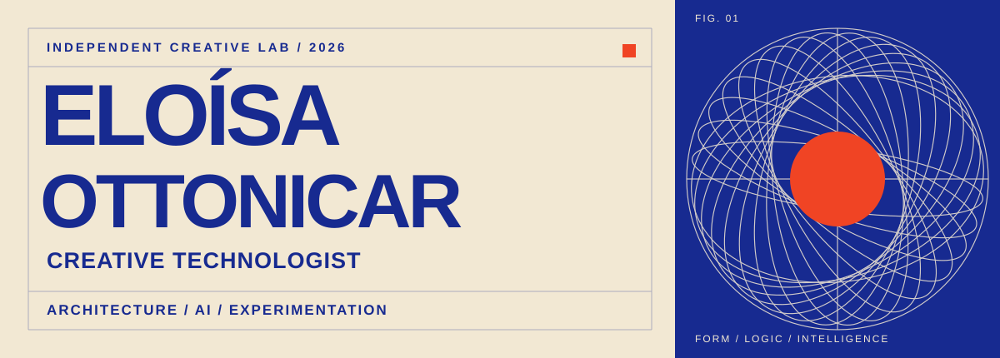
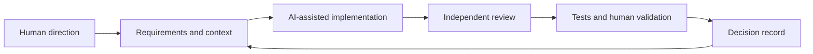

# Intelligence meets imagination.

**Architect · Creative Technologist · Independent AI Developer**

I build digital products and experimental intelligent systems at the intersection of architecture, design and artificial intelligence. My work combines spatial thinking, product design, context management and AI-assisted software development.

Based in Brazil. Open to professional opportunities and technical collaborations.

[LinkedIn](https://www.linkedin.com/in/arqeloisaottonicar/) · [Behance](https://www.behance.net/gallery/259019933/ATELIE-CAPILAR-Architecture-of-Hair) · [Português ↓](#sobre-mim)

---

## 01 / Selected projects

| Project | Research & development focus | Stage |
| :--- | :--- | :--- |
| **LINEA** | AI-assisted architectural project continuity, persistent context, decision history and contextual assistants | In development |
| **RUPTURE WORLD** | Experimental multi-agent ecosystem: agent roles, operational rules and communication | Experimental |
| **ÍRIS** | Domain-specific AI assistant for hair science, multimodal interaction and structured records | Prototype / application |
| **[ATELIÊ CAPILAR](https://www.behance.net/gallery/259019933/ATELIE-CAPILAR-Architecture-of-Hair)** | Architecture of hair: spatial thinking, geometry, visual identity and creative technology | Public creative case study |

Selected source repositories remain private. Public documentation and demonstrations will be added as they become ready.

## 02 / Technical focus

| Intelligent systems | Product & development | Creative practice |
| :--- | :--- | :--- |
| AI agents & LLMs | React, Vite | Architecture & interiors |
| Prompt engineering | JavaScript / TypeScript | 3D modeling & visualization |
| Context & memory | SQLite, API integration | Computational design exploration |
| Agent interaction design | Git, Vercel | Visual communication |

These are technologies and methods explored through hands-on projects, not a claim of equal proficiency in every tool.

## 03 / How I build

I experiment with complementary AI coding assistants, including Claude and Codex, while retaining human direction over requirements, design decisions and validation.

*Conceptual development workflow, not a production architecture diagram.*

My priorities are explicit decisions, clear responsibilities, reproducible changes and preservation of project context.

## 04 / Background

Bachelor's degree in Architecture and Urbanism, Universidade de Marília (UNIMAR), 2021.

Interested in AI applications, agent development, creative technology, digital product development and architectural visualization.

---

## Sobre mim

Sou arquiteta e urbanista, formada em 2021, e desenvolvedora independente de soluções com IA. Investigo como o pensamento arquitetônico pode contribuir para a criação de sistemas inteligentes, interfaces e produtos digitais.

Meus projetos autorais incluem LINEA, Rupture World, ÍRIS e Ateliê Capilar. Trabalho com desenvolvimento assistido por IA, prototipagem, engenharia de prompts, integração de APIs, gestão de contexto e validação de aplicações.

Estou aberta a oportunidades profissionais e colaborações em inteligência artificial, tecnologia criativa, desenvolvimento de produtos e visualização 3D.

**[LinkedIn](https://www.linkedin.com/in/arqeloisaottonicar/) · [Behance](https://www.behance.net/gallery/259019933/ATELIE-CAPILAR-Architecture-of-Hair)**

---

*Independent creative lab / Brazil / 2026*
