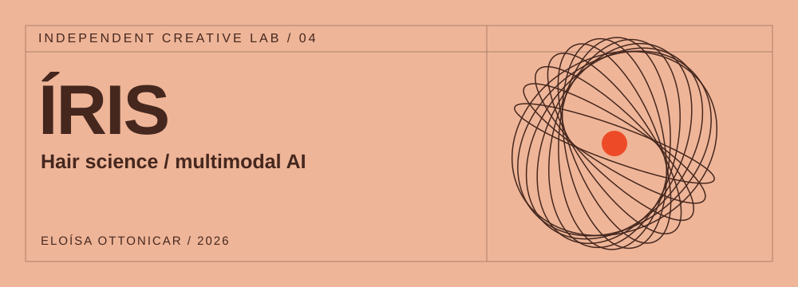
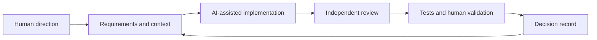

# Intelligence meets imagination.

**Architect · Creative Technologist · Independent AI Developer**

I build digital products and experimental intelligent systems at the intersection of architecture, design and artificial intelligence. My work combines spatial thinking, product design, context management and AI-assisted software development.

Based in Brazil. Open to professional opportunities and technical collaborations.

[Portfolio website](https://eottonicar.github.io/eottonicar/) · [LinkedIn](https://www.linkedin.com/in/arqeloisaottonicar/) · [Behance](https://www.behance.net/gallery/259019933/ATELIE-CAPILAR-Architecture-of-Hair) · [Português ↓](#sobre-mim)

---

## 01 / Flagship project

**ATELIÊ CAPILAR / Architecture of Hair** · Experimental software & creative research

What if hair were approached as an architectural design object? An independent investigation of matter, form, color and perception, with a procedural geometry prototype and AI-assisted development. I lead the concept, product direction and aesthetic decisions.

[Explore the dedicated project page](https://eottonicar.github.io/eottonicar/atelie-capilar.html) · [Technical case study](projects/atelie-capilar.md) · [Visual portfolio on Behance](https://www.behance.net/gallery/259019933/ATELIE-CAPILAR-Architecture-of-Hair)

## 02 / Other selected projects

|  |  |
| :--- | :--- |
| **[LINEA](projects/linea.md)** · In development | **[RUPTURE WORLD](projects/rupture-world.md)** · Experimental |
| Context, persistent memory and decision history. | Agent roles, interaction rules and coordination. |
|  | **[Architecture & web portfolio](https://github.com/eottonicar/eloisa-ottonicar-arquitetura-narrativa)** |
| **[ÍRIS](projects/iris.md)** · Application prototype | Architecture, visual communication and web exploration. |
| Multimodal specialist assistance and structured records. | |

Project source repositories remain private. These case studies are public summaries, not source releases.

[Visit the interactive portfolio](https://eottonicar.github.io/eottonicar/)

## 03 / Technical focus

| Intelligent systems | Product & development | Creative practice |
| :--- | :--- | :--- |
| AI agents & LLMs | React, Vite | Architecture & interiors |
| Prompt engineering | JavaScript / TypeScript | 3D modeling & visualization |
| Context & memory | SQLite, API integration | Computational design exploration |
| Agent interaction design | Git, Vercel | Visual communication |

These are technologies and methods explored through hands-on projects, not a claim of equal proficiency in every tool.

## 04 / How I build

I experiment with complementary AI coding assistants, including Claude and Codex, while retaining human direction over requirements, design decisions and validation.

*Conceptual development workflow, not a production architecture diagram.*

My priorities are explicit decisions, clear responsibilities, reproducible changes and preservation of project context.

## 05 / Background

Bachelor's degree in Architecture and Urbanism, Universidade de Marília (UNIMAR), 2021.

Interested in AI applications, agent development, creative technology, digital product development and architectural visualization.

---

## Sobre mim

Sou arquiteta e urbanista, formada em 2021, e desenvolvedora independente de soluções com IA. Investigo como o pensamento arquitetônico pode contribuir para a criação de sistemas inteligentes, interfaces e produtos digitais.

Meus projetos autorais incluem LINEA, Rupture World, ÍRIS e Ateliê Capilar. Trabalho com desenvolvimento assistido por IA, prototipagem, engenharia de prompts, integração de APIs, gestão de contexto e validação de aplicações.

Estou aberta a oportunidades profissionais e colaborações em inteligência artificial, tecnologia criativa, desenvolvimento de produtos e visualização 3D.

**[LinkedIn](https://www.linkedin.com/in/arqeloisaottonicar/) · [Behance](https://www.behance.net/gallery/259019933/ATELIE-CAPILAR-Architecture-of-Hair)**

---

*Independent creative lab / Brazil / 2026*
