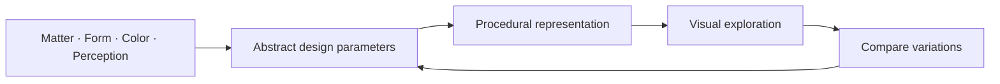

[← Portfolio](../README.md) · [Interactive project page](https://eottonicar.github.io/eottonicar/atelie-capilar.html) · [Behance](https://www.behance.net/gallery/259019933/ATELIE-CAPILAR-Architecture-of-Hair)

# ATELIÊ CAPILAR / Architecture of Hair

**Flagship project · Experimental computational design and software research · 2026**

## Manifesto

Hair is investigated as a design material: its volume, geometry, chromatic distribution and relationship with perception. Architecture provides a way to formulate the problem, not a promise of a universal rule for beauty.

## Experiment 001 / Hair as territory

The project includes an experimental native WebGL proof of concept using a synthetic hair object, region-based procedural geometry, abstract shape parameters, color, material and light, an orbital camera and saved variations.

This is a computational and artistic representation, not a calibrated model of real hair.

## Technical direction

| Layer | Purpose |
| --- | --- |
| Geometry | Procedural representation of synthetic regions |
| Interaction | Explore shape, color, material and viewpoints |
| State | Preserve and compare independent variations |
| Validation | Test geometry and data handling; review visual behavior |

Conceptual flow, not an implementation or deployment diagram.

## Authorship and process

Eloísa Ottonicar is the originator and creative director. She leads the problem framing, product direction, design intent and decisions. ChatGPT supports conceptual and creative exploration; Codex and Claude/Claude Code support technical implementation, investigation and review. AI collaboration is not independent scientific peer review.

## Evidence and limits

- A procedural WebGL prototype is documented in the project; development and validation are ongoing.
- The public interactive illustration is separately authored for this portfolio. It is not the private prototype or a screenshot of it.
- No validated hair-fiber physics, haircut prediction, chemical outcome prediction, personality inference or clinical assessment is claimed.
- No verified prototype screenshots or recordings are included in this public release. No private source code, research library or client data is published.

## Next public milestone

Record a real prototype walkthrough using synthetic data, with a version label and clearly documented validation scope.

## Português

O Ateliê Capilar investiga cabelo como matéria, forma, distribuição cromática e relação perceptiva. A prova experimental utiliza geometria procedural em WebGL e permite explorar parâmetros abstratos e variações. Eloísa é idealizadora e diretora criativa, com desenvolvimento assistido por IA. A demonstração pública é uma ilustração conceitual independente, não uma simulação física ou previsão química.

[Explorar página do projeto](https://eottonicar.github.io/eottonicar/atelie-capilar.html) · [Projeto visual no Behance](https://www.behance.net/gallery/259019933/ATELIE-CAPILAR-Architecture-of-Hair)
