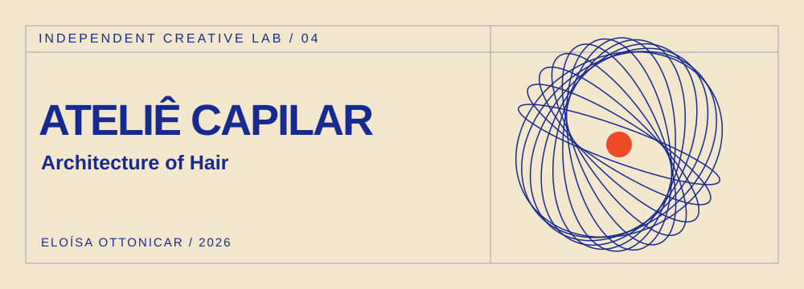

[← Portfolio index](../README.md)

# ATELIÊ CAPILAR / Architecture of Hair

**Stage:** Public creative study · **Role:** Independent creator and AI-assisted developer / design researcher

## Problem
How can architectural thinking inform the study of hair, form, color and visual identity?

## Approach
A creative investigation connecting spatial composition, geometry, capillary science, visagism and experimental technology.

## My contribution
Concept, visual research, graphic identity and the multidisciplinary direction of the project.

## Conceptual flow

This is a conceptual illustration, not a verified production architecture.

## Evidence and scope
A public visual presentation is available on Behance. This case study does not imply scientific validation of an algorithm or completed commercial software.

## Next public milestone
Document the design process with examples, references and a clear distinction between visual experiments and tested technical features.

## Resumo em português
Arquitetura, geometria, identidade visual e pesquisa criativa. Este estudo apresenta a proposta e a contribuição autoral; não inclui código privado, dados pessoais ou métricas não verificadas.

[Visual case study on Behance](https://www.behance.net/gallery/259019933/ATELIE-CAPILAR-Architecture-of-Hair)

