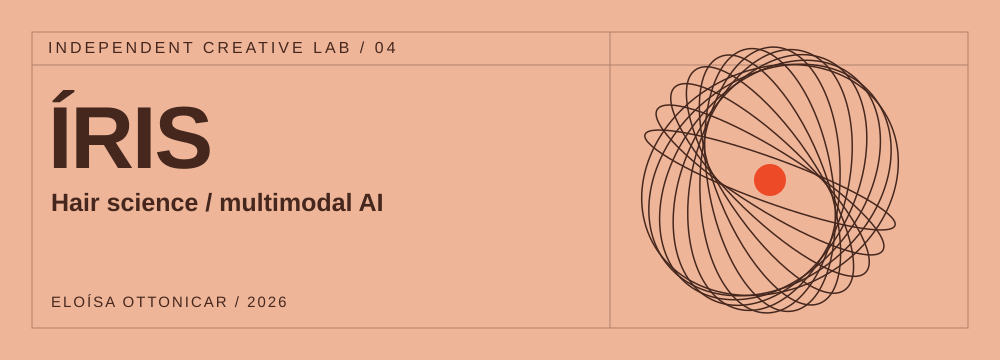

[← Portfolio index](../README.md)

# ÍRIS / Hair science / multimodal AI

**Stage:** Application prototype · **Role:** Independent creator and AI-assisted developer / design researcher

## Problem
Hair-care information is often fragmented between conversations, visual observations and individual records.

## Approach
A domain-specific assistant combining conversational interaction, image and audio inputs, structured records and contextual guidance.

## My contribution
Product direction, interaction design, domain requirements and AI-assisted implementation and iteration.

## Conceptual flow

This is a conceptual illustration, not a verified production architecture.

## Evidence and scope
The project has explored React, Vite, a PWA interface and AI API integration. It is not a clinically validated diagnostic tool and does not replace professional assessment.

## Next public milestone
A demonstration with synthetic records and clear limits on automated recommendations.

## Resumo em português
Assistência especializada, interação multimodal e registros estruturados. Este estudo apresenta a proposta e a contribuição autoral; não inclui código privado, dados pessoais ou métricas não verificadas.

