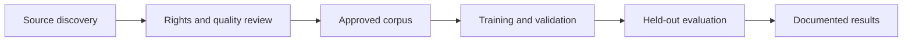

# LAB-IA / Independent research in specialized language models

**Status:** early-stage research and development, not a deployed or validated professional AI product.

## Research question

Can a small, locally executed language-model research pipeline be developed into a reusable foundation for domain-specialized professional assistance, with traceable knowledge, explicit evaluations and deterministic tools?

## Initial experiment

I started with a small causal Transformer implemented using PyTorch and trained from randomly initialized weights. The first experiment uses character-level tokenization and a deliberately small corpus. Its purpose is to understand and verify the training pipeline, not to establish scientific or professional competence.

This work explores neural architecture, data preparation, checkpoint integrity, reproducibility and evaluation. A lower training loss alone is not evidence of generalization or factual accuracy.

## Research directions

- **CAPILAR AI:** the first domain specialization, focused on hair science and professional hairdressing.
- **Architecture and urbanism:** a proposed second specialization, informed by my professional background. It is a future research direction, not a trained model or released product.
- **Shared infrastructure:** reusable training and evaluation pipelines, versioned datasets, local inference and carefully controlled tool interfaces.

## Research methodology

*Target research workflow; not all stages are implemented or validated.*

The scientific corpus is being collected and reviewed. Catalogued sources must not be treated as approved training data. Licensing, source relevance, extraction quality and traceability are separate review steps. Evaluation must use held-out material and avoid leakage between training and test sets.

## My role and engineering workflow

I define the research questions, product direction and acceptance criteria, participate in terminal-based experiments, and review technical results with AI coding assistants. Codex and Claude contribute implementation and investigation; GitHub Copilot is used for independent code review. I am developing my own Python and machine-learning skills through these experiments.

## Next milestones

1. Establish a rights-reviewed, traceable corpus.
2. Establish versioned, reproducible training runs and checkpoint preservation.
3. Evaluate language-model generalization and domain-specific accuracy.
4. Investigate structured tool use and retrieval with explicit sources.
5. Validate usefulness and safety with domain professionals before commercial deployment.

The original source repositories, datasets, checkpoints and weights remain private. This page is a public research overview, not a reproducibility package, a model release or a claim of professional readiness.

## Português

O LAB-IA é um laboratório independente de pesquisa em modelos de linguagem especializados. O primeiro experimento é um Transformer pequeno treinado do zero em PyTorch, com tokenização por caracteres. A investigação prioriza a qualidade e o licenciamento do corpus, o aprendizado técnico, a avaliação e a reprodutibilidade. CAPILAR AI é a primeira especialização; arquitetura e urbanismo constituem uma direção futura. Nenhum modelo é apresentado como validado para uso profissional.

[Return to profile](../README.md)
