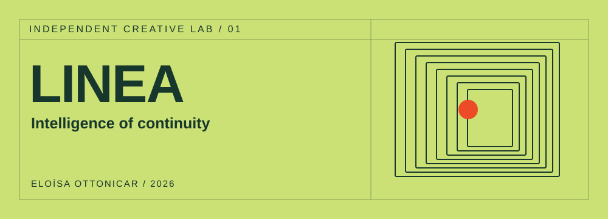
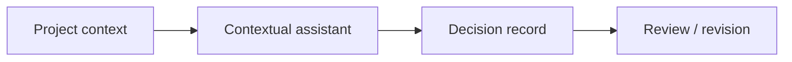

[← Portfolio index](../README.md)

# LINEA / Intelligence of continuity

**Stage:** In development · **Role:** Independent creator and AI-assisted developer / design researcher

## Problem
Long-running design projects accumulate decisions, revisions and context. A conventional chat history is not always enough to distinguish current decisions from superseded ones.

## Approach
A project-oriented assistant with scoped conversations, persistent context and a decision history that makes changes explicit.

## My contribution
Product concept, requirements, interaction design, context rules and validation in an AI-assisted development workflow.

## Conceptual flow

This is a conceptual illustration, not a verified production architecture.

## Evidence and scope
The project has explored SQLite persistence, LLM integration, decision records and end-to-end testing. No production scale, commercial performance or verified test count is claimed here.

## Next public milestone
Public walkthrough using fictional project data; independently reproducible tests for context boundaries and decision lifecycle.

## Resumo em português
Assistência contextualizada, memória persistente e histórico de decisões. Este estudo apresenta a proposta e a contribuição autoral; não inclui código privado, dados pessoais ou métricas não verificadas.

