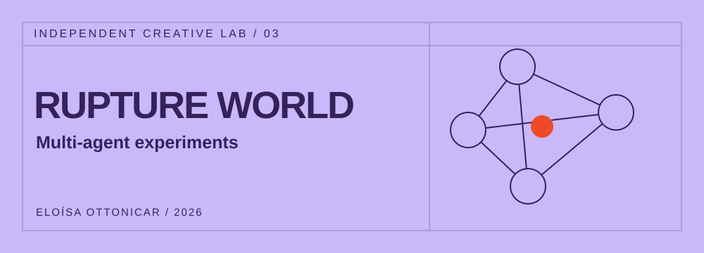
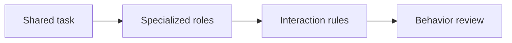

[← Portfolio index](../README.md)

# RUPTURE WORLD / Multi-agent experiments

**Stage:** Experimental · **Role:** Independent creator and AI-assisted developer / design researcher

## Problem
When several AI agents have distinct roles, responsibility and communication need to be explicit; more agents do not automatically make a system more reliable.

## Approach
An experimental ecosystem exploring specialized roles, interaction rules and coordination between agents.

## My contribution
Concept development, role definition, operational rules, documentation and behavioral investigation.

## Conceptual flow

This is a conceptual illustration, not a verified production architecture.

## Evidence and scope
This is an exploratory project. The portfolio describes its research direction; it does not claim distributed production infrastructure, autonomous execution at scale or measured performance.

## Next public milestone
Publish a minimal synthetic scenario with expected behavior, failure modes and a documented evaluation method.

## Resumo em português
Papéis, regras operacionais e coordenação entre agentes. Este estudo apresenta a proposta e a contribuição autoral; não inclui código privado, dados pessoais ou métricas não verificadas.

